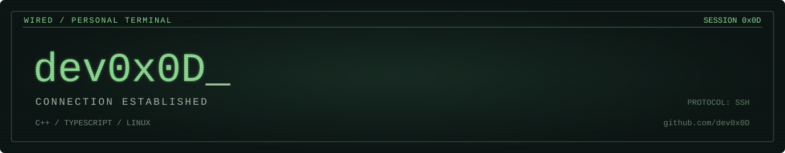
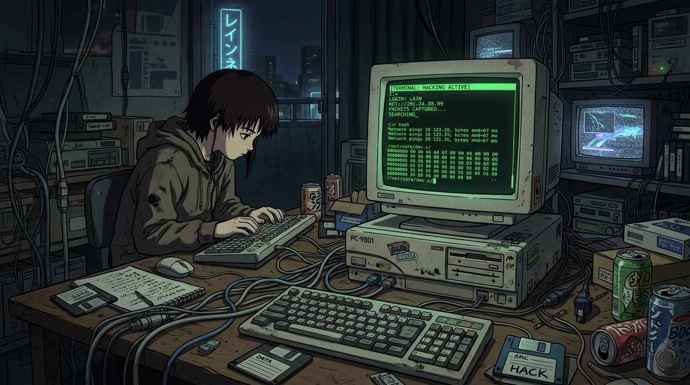

<div align="center">





<br><br>

`C++` &nbsp; / &nbsp; `TypeScript` &nbsp; / &nbsp; `Linux`

<br>

</div>

```text
guest@wired:~$ ls projects/
```

| Project | Signal |
| :--- | :--- |
| **[riffer](https://github.com/dev0x0D/riffer)** | Practice player for Linux. Pitch-preserving speed control, loops, zoomable waveform and sections for MP3/WAV. `C++` |
| **[fit](https://github.com/dev0x0D/fit)** | `TypeScript` |

<br>

<div align="center">

<sub><code>the network is vast. make something worth finding.</code></sub>

</div>
