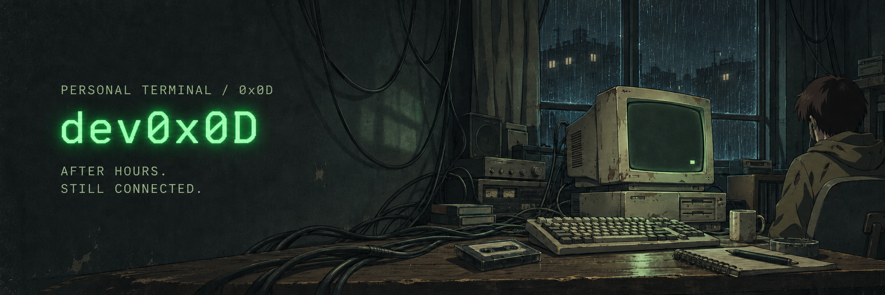
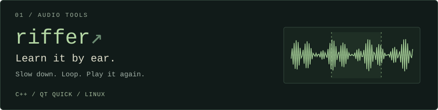
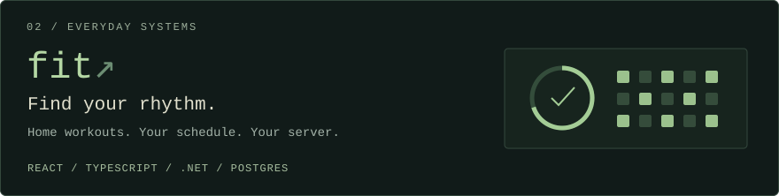
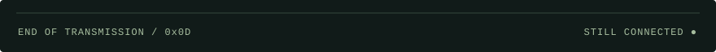

<samp>Small tools. Personal rhythms. A little less friction.</samp>

I build things for music, movement, and everyday life. 
Native Linux software and self-hosted web apps.

[Projects](#selected-work) · [Repositories](https://github.com/dev0x0D?tab=repositories) · [Leave a signal](https://github.com/dev0x0D/dev0x0D/issues/new)

### Selected work

<a href="https://github.com/dev0x0D/riffer"><picture><source media="(max-width: 600px)" srcset="assets/riffer-mobile.svg"></picture></a>

<a href="https://github.com/dev0x0D/fit"><picture><source media="(max-width: 600px)" srcset="assets/fit-mobile.svg"></picture></a>

Read the project notes

**[riffer](https://github.com/dev0x0D/riffer)** — slow a track down without changing its pitch, loop the difficult part, and work through it by ear. Built with C++ and Qt Quick for Linux.

**[fit](https://github.com/dev0x0D/fit)** — plan home workouts, follow sessions, and track progress. A self-hosted PWA built with React, TypeScript, ASP.NET Core, and Postgres.

 

### On the workbench

`C++` `Qt Quick` `TypeScript` `React` `C# / .NET` `Postgres` 
`Linux` `Docker` `Git`

 

